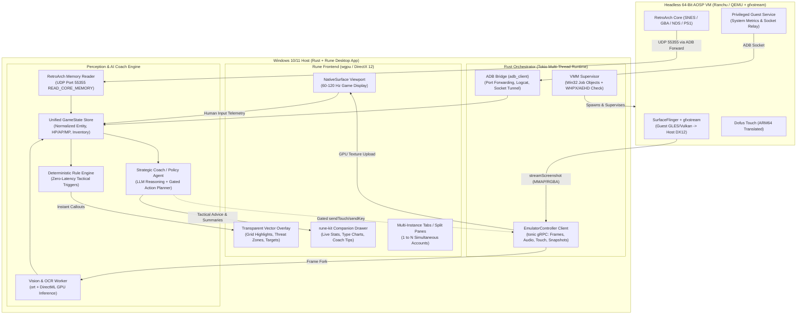
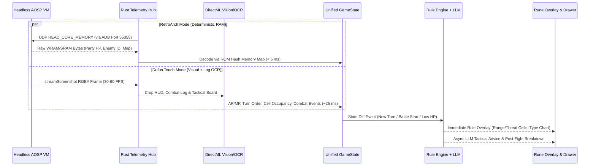
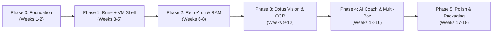

# Project Master Plan: Windows AOSP AI Game Coach & Autonomous Desktop Client

> Original plan, kept verbatim. Read [REVIEW.md](REVIEW.md) before acting on it.

This blueprint consolidates the full technical architecture, telemetry pipelines, AI coaching loop, and phased execution roadmap for building a Windows-native Rust desktop application powered by **Rune**, backed by a **custom 64-bit AOSP virtual machine**, tailored for tactical MMOs (**Dofus Touch**) and classic console RPGs (**RetroArch**).

All architectural parameters, thresholds, and design choices requiring final team sign-off before implementation are explicitly tagged as **`Must Define`**.

---

## 1. High-Level System Architecture

The system separates **Windows Host Presentation & AI Reasoning** from **Headless AOSP Execution**. The Android guest runs without a native OS window; its framebuffer, audio, and internal state stream into the Rust host, where Rune composites the game screen alongside a zero-overhead vector overlay and companion drawer.

### Core Technology Stack

| Layer | Technology / Crate | Role |
| --- | --- | --- |
| **Desktop UI & Rendering** | `rune`, `rune-kit`, `rune-motion` (`anomalyco/rune`) | Native `wgpu` (DX12) windowing, `NativeSurface` video viewport, spring-animated drawers, and vector overlays. |
| **Async Runtime & IPC** | `tokio`, `tonic`, `prost` | Asynchronous frame streaming, gRPC emulator control, and non-blocking AI worker pipelines. |
| **Hypervisor & Process Control** | `emulator.exe` (WHPX/AEHD) + `windows` crate | Headless AOSP VM execution bound to a Win32 `JobObject` (`KILL_ON_JOB_CLOSE`) for crash-safe cleanup. |
| **Guest Communication** | `adb_client` (pure Rust) + `std::net::UdpSocket` | ADB port forwarding, device health checks, and RetroArch UDP memory polling. |
| **Local ML / Vision Inference** | `ort` (ONNX Runtime with DirectML) | Hardware-accelerated HUD OCR and board/sprite detection on AMD, NVIDIA, and Intel GPUs. |
| **Reasoning & Coaching** | **`Must Define`** (Local `llama.cpp`/Ollama vs. Cloud VLM/LLM API) | Turn-by-turn strategic analysis, post-match review, and optional autonomous action generation. |

---

## 2. Subsystem Specifications & `Must Define` Decisions

### A. Custom AOSP Guest Image & Windows Virtualization

* **Execution Engine:** Headless Android Emulator (`qemu-system-x86_64.exe` / `emulator.exe -no-window -gpu host -grpc <port>`) accelerated via Windows Hypervisor Platform (**WHPX**) or **AEHD**.
* **64-Bit Architecture & Binary Translation:** Must compile a 64-bit target (`sdk_phone64_x86_64`) with ARM64 translation enabled so 64-bit-only APKs (such as Dofus Touch 1.79+) execute smoothly on x86_64 Windows PCs.
* **Device Integrity & Clean Fingerprint:** Build as `user` (release-keys) with sanitized `ro.product.*`, `ro.build.tags`, and `ro.kernel.qemu` properties to present a standard Android tablet profile.
* **Project Parameters (`Must Define`):**
  * **`Must Define` — AOSP Base Version:** Select Android 14 (API 34) or Android 15 (API 35) source branch.
  * **`Must Define` — ARM64 Translation Layer:** Choose between AOSP `libndk_translation` or licensed/extracted Intel `houdini` binaries.
  * **`Must Define` — Guest Display Resolution & DPI:** Standardize canonical virtual resolution (e.g., `1920x1080` at `240 dpi` or `1600x900`) so HUD OCR crop coordinates remain invariant across user monitors.
  * **`Must Define` — Image Distribution Strategy:** Define how the 2–4 GB AOSP system/vendor images are hosted, chunk-downloaded, checksum-verified, and patched on end-user Windows machines.

### B. Rune Desktop Shell & Multi-Instance Viewport

* **Zero-Copy / Low-Latency Video Path:** Receive raw RGBA/BGRA frames from `EmulatorController::streamScreenshot` (using shared memory `MMAP` mode where supported) and upload directly to a `wgpu::Texture` bound to Rune's `NativeSurface`, triggering `Tx::live_only()` repaints.
* **Transparent Spatial Overlay:** Composite a custom `wgpu` 2D vector canvas aligned 1:1 with `NativeSurface` coordinates to draw tactical grids, range/line-of-sight overlays, entity bounding boxes, and click indicators without touching the Android framebuffer.
* **Multi-Account Tab & Split Architecture:** Support running multiple isolated AVD instances simultaneously inside Rune tabs or side-by-side panes, sharing a single unified Rust Coach instance capable of cross-character turn coordination.
* **Project Parameters (`Must Define`):**
  * **`Must Define` — Pinned Rune Commit SHA:** Lock an exact `rev` from `anomalyco/rune` (`dev` branch) and verify DX12 `NativeSurface` texture-upload throughput at 60 FPS.
  * **`Must Define` — Max Concurrent VM Instances:** Cap simultaneous VMs (e.g., 1 default, up to 4 for Dofus Touch multi-accounting) and specify minimum host RAM/VRAM requirements (e.g., 16 GB RAM for 1 VM, 32 GB RAM for 4 VMs).
  * **`Must Define` — Window & Overlay Hotkeys:** Define global/app shortcuts for toggling the tactical overlay, switching autonomous vs. manual mode, and triggering snapshot rewinds.

### C. Dual-Mode Game Telemetry Pipeline

1. **RetroArch Pipeline (Classic RPGs — Pokémon, Final Fantasy, etc.):**
   * Enable RetroArch's Network Command Interface (`network_cmd_enable = "true"`, UDP port `55355`) inside the AOSP RetroArch config and forward it to Windows via `adb_client`.
   * On ROM load, hash the ROM header (`MD5`/`CRC32`) to load the matching memory address table (WRAM/SRAM offsets for party stats, active moves, enemy species/level, status flags, and inventory).
   * Fallback to lightweight screenshot OCR only when running unmapped custom ROM hacks.
2. **Dofus Touch Pipeline (Tactical MMO):**
   * **HUD & Combat Log Cropper:** Extract fixed regions of interest (ROIs) from the canonical framebuffer for AP/MP counters, HP/Shield, spell cooldowns, turn timeline portraits, and combat chat text.
   * **Board & Entity Detector:** Run a lightweight quantized ONNX object-detection model (`YOLOv8-nano` / `RT-DETR`) via `ort` + DirectML to map isometric grid cells, obstacles, allies, and enemy positions.
   * **Input Telemetry:** Intercept human clicks/keys in Rune before forwarding to `sendTouch`/`sendKey` to log player decisions, APM, and turn time.
3. **Project Parameters (`Must Define`):**
   * **`Must Define` — Initial Supported Game Roster:** Select the exact launch titles (e.g., *Dofus Touch* + *Pokémon Emerald / FireRed* + *Final Fantasy VI / VII*).
   * **`Must Define` — RetroArch Memory Schema Format:** Standardize on RetroAchievements JSON code notes or a custom TOML memory-map schema for WRAM byte decoding.
   * **`Must Define` — Dofus Touch OCR & Vision Dataset:** Define the labeling workflow and synthetic/recorded screenshot dataset required to train the isometric board/entity detector and French/English combat-log OCR.

### D. AI Coach, Rewind Checkpoints & Gated Autonomy

* **Two-Tier Decision Loop:**
  * *Tier 1 — Deterministic Rule Engine (< 10 ms):* Computes elemental type effectiveness, lethal damage thresholds, AP/MP remaining combos, and danger zones immediately on state change.
  * *Tier 2 — LLM Strategic Coach (500 ms – 2 s):* Evaluates turn-by-turn strategy, explains optimal plays in natural language inside the `rune-kit` sidebar, and generates post-battle mistake summaries.
* **Snapshot Checkpoints ("Rewind & Retry"):** Use `EmulatorController` `SnapshotService` to auto-save VM state at the start of boss fights or difficult encounters, allowing one-click rollback in ~1 second to practice alternative strategies.
* **Gated Autonomous Execution:** Architect the action emitter (`sendTouch` / `sendKey`) behind an explicit `ExecutionMode` policy (`ReadOnlyCoach`, `AssistedClickConfirm`, `AutonomousAgent`) so autonomous play works seamlessly for offline RetroArch RPGs and internal testing while enforcing read-only compliance on live online servers.
* **Project Parameters (`Must Define`):**
  * **`Must Define` — LLM Provider & Latency Budget:** Decide between an embedded local model (e.g., quantized 3B–8B model via `llama.cpp`), user-configured API keys (OpenAI/Anthropic/Gemini), or a hybrid setup, plus max per-turn inference latency.
  * **`Must Define` — Voice / TTS Feedback:** Decide whether the coach includes local Text-to-Speech (`tts` crate / Windows SAPI) for audio callouts or strictly visual UI feedback.
  * **`Must Define` — Autonomy Policy Enforcement:** Define how `AutonomousAgent` mode is gated (e.g., restricted to offline/RetroArch profiles or local test environments) to protect user accounts from MMO anti-cheat/ToS violations.

---

## 3. Phased Development Roadmap

### Phase 0: Specification Lock & Environment Setup (Weeks 1–2)

* Resolve all **`Must Define`** items listed in Section 2.
* Set up the Linux/WSL2 AOSP build server and Windows 11 Rust/Rune development machines.
* Stand up a barebones `cargo` workspace pinning `rune`, `rune-kit`, `rune-motion`, `tonic`, `adb_client`, and `ort`.
* **Exit Criteria:** Team sign-off on all `Must Define` specs; hello-world Rune window compiling cleanly on Windows with DX12 backend.

### Phase 1: Custom AOSP Image & Rune Viewport Integration (Weeks 3–5)

* Compile the 64-bit AOSP target (`sdk_phone64_x86_64`) with ARM64 translation, sanitized device fingerprint, and `gfxstream` enabled.
* Build the Rust `VmmSupervisor` using Win32 Job Objects to launch and cleanly terminate headless `emulator.exe` instances with WHPX/AEHD preflight diagnostics.
* Stream `EmulatorController::streamScreenshot` frames into Rune's `NativeSurface` at 60 FPS and forward mouse/keyboard events via `sendTouch`/`sendKey`.
* **Exit Criteria:** Booting custom AOSP inside the Rune desktop window on Windows with < 35 ms input-to-photon latency and zero orphaned QEMU processes on app exit.

### Phase 2: RetroArch Telemetry & Deterministic RPG Coach (Weeks 6–8)

* Bundle/provision RetroArch in the AOSP image with UDP port `55355` enabled and forwarded via `adb_client`.
* Implement the Rust `MemoryMapEngine` to poll WRAM addresses every 100 ms and populate the `GameState` store.
* Build the `rune-kit` RPG Companion Drawer (live party HP/status, enemy elemental weakness matrix, catch-rate calculator, and `SnapshotService` boss-fight rewind button).
* **Exit Criteria:** Playing Pokémon or Final Fantasy inside Rune updates enemy weaknesses, move recommendations, and save-state checkpoints automatically in real time.

### Phase 3: Dofus Touch Vision/OCR Pipeline & Spatial Overlay (Weeks 9–12)

* Implement the DirectML-accelerated `VisionWorker` (`ort`) for HUD ROI cropping (AP/MP, HP, turn timeline) and combat-log OCR.
* Train and integrate the isometric grid & entity detector to reconstruct the tactical board state in `GameState`.
* Build Rune's transparent 2D vector overlay above `NativeSurface` to highlight movement/spell range tiles, line-of-sight blockers, and enemy threat ranges.
* **Exit Criteria:** Real-time board state reconstruction and accurate tile/range overlays rendered smoothly over Dofus Touch at 60 FPS.

### Phase 4: LLM Strategic Coach, Multi-Instance & Gated Autonomy (Weeks 13–16)

* Connect the `GameState` diff stream to the Tier 2 LLM Coach for turn-by-turn tactical advice and post-combat replay breakdowns.
* Add multi-instance tab/split-pane support in Rune so 2–4 AOSP instances share a coordinated tactical timeline.
* Wire the gated `AutonomousAgent` execution controller for automated RPG grinding/testing in offline profiles.
* **Exit Criteria:** End-to-end tactical coaching across single and multi-account sessions, plus verified autonomous turn execution on offline RetroArch test runs.

### Phase 5: Hardening, Installer & Telemetry Calibration (Weeks 17–18)

* Implement first-run onboarding wizard (WHPX verification, AOSP image downloader/verifier, GPU benchmark).
* Profile VRAM/RAM usage under multi-instance load and optimize frame-buffer pooling.
* **Exit Criteria:** Reproducible Windows installer (`.msi` / `.exe`) tested across clean Windows 10/11 machines with NVIDIA, AMD, and Intel GPUs.

---

## 4. Risk & Compliance Matrix

| Risk Area | Impact | Mitigation Strategy |
| --- | --- | --- |
| **MMO Anti-Cheat / ToS Enforcement (Dofus Touch)** | Account suspension if automated input injection or memory tampering is detected on live servers. | Keep Dofus Touch integration strictly **read-only** (external framebuffer analysis + host-side Rune overlay); disable `sendTouch` automation when an online MMO package is in the foreground. |
| **Rune Pre-Release API Churn** | Breaking builds if upstream `anomalyco/rune` changes widget or `NativeSurface` signatures. | Pin an exact commit `rev` in `Cargo.toml`, vendor critical patches if needed, and leverage Rune's headless PNG snapshot runner in CI to catch UI regressions. |
| **Multi-VM Resource Exhaustion** | Host stuttering or OOM crashes when running 3–4 AOSP VMs alongside DirectML inference. | Enforce dynamic FPS throttling (e.g., 60 FPS on active tab, 15 FPS on background tabs) and share a single ONNX Runtime session across all VM streams. |
| **Game UI Patch Drift** | Dofus Touch updates shifting HUD coordinates or icons and breaking OCR/detection. | Externalize all HUD ROI coordinates and model weights into hot-reloadable JSON/ONNX manifest bundles updated independently of the Rust binary. |
